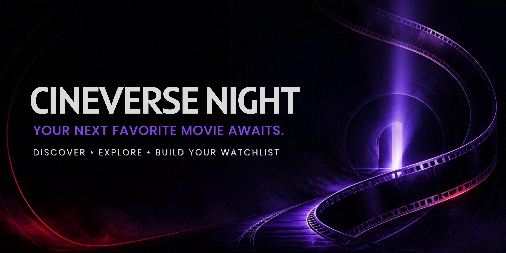

<div align="center">

**Your next favorite movie awaits.**

Discover movies. Explore genres. Build your watchlist.

</div>

---

# 🎬 CineVerse Night

**A cinematic movie-discovery experience built with React, TypeScript, and Tailwind CSS.**

CineVerse Night is a dark-themed movie browsing web application designed to make exploring films more engaging. Browse movies by genre, discover titles through search and filters, view detailed movie information, and build a personal watchlist through a clean, responsive interface.

🔗 **Live Preview:** [Open CineVerse Night on Lovable](https://lovable.dev/projects/38716783-97fe-416c-9e77-17dbbab769eb)
💻 **Source Code:** [GitHub Repository](https://github.com/abihaha7/cine-verse-night)


## ✨ Features

- **Cinematic Home Page** — Featured movie presentation and curated movie rows.
- **Genre-Based Discovery** — Browse categories and explore movies within individual genres.
- **Smart Movie Search** — Search by movie title, director, cast, or genre.
- **Advanced Filtering & Sorting** — Narrow results by genre and release year, then sort by title, year, or rating.
- **Movie Details** — Explore synopses, cast, directors, ratings, release years, and durations.
- **Personal Watchlist** — Add or remove movies and switch between grid and list views.
- **Video Player Interface** — Custom playback controls for play/pause, seeking, volume, playback speed, and fullscreen.
- **Trailer Embeds** — View embedded YouTube trailers where available.
- **Related Movie Recommendations** — Discover other titles that share genres.
- **Responsive Navigation** — Browse the application through desktop and mobile navigation layouts.

## 🛠️ Tech Stack

| Technology | Purpose |
|---|---|
| React 18 | Component-based user interface |
| TypeScript | Type-safe application development |
| Vite | Development server and production build tooling |
| Tailwind CSS | Utility-first styling and responsive layouts |
| shadcn/ui & Radix UI | Reusable interface components |
| React Router | Client-side navigation |
| Lucide React | Interface icons |
| TanStack React Query | Server-state and data-fetching infrastructure |

## 🚀 Getting Started

### Prerequisites

- [Node.js](https://nodejs.org/) — preferably a current LTS release
- npm, included with Node.js
- Git

### Installation

**1. Clone the repository**

```bash
git clone https://github.com/abihaha7/cine-verse-night.git
```

**2. Navigate to the project**

```bash
cd cine-verse-night
```

**3. Install dependencies**

```bash
npm install
```

**4. Start the development server**

```bash
npm run dev
```

Open the local URL printed in your terminal to explore the application.

## 📁 Project Structure

```text
cine-verse-night/
├── public/                 # Public static assets
├── src/
│   ├── components/         # Navbar, movie cards, player, and UI
│   ├── contexts/           # Watchlist state management
│   ├── data/               # Sample movie catalog and categories
│   ├── hooks/              # Custom React hooks
│   ├── lib/                # Shared utilities
│   ├── pages/              # Home, search, categories, details, watchlist
│   ├── types/              # TypeScript movie definitions
│   ├── App.tsx             # Routes and application providers
│   └── main.tsx            # Application entry point
├── index.html
├── package.json
├── tailwind.config.ts
├── tsconfig.json
└── vite.config.ts
```

## 🧪 Available Scripts

| Command | Description |
|---|---|
| `npm run dev` | Start the local development server |
| `npm run build` | Generate a production build |
| `npm run build:dev` | Generate a development-mode build |
| `npm run preview` | Preview the production build locally |
| `npm run lint` | Run ESLint checks |

## 📝 Current Implementation Notes

- The movie catalog uses locally defined sample data.
- The watchlist currently uses in-memory React state; it is not persisted across page reloads.
- The video player uses a sample MP4 source, so playback is a demonstration rather than a full-length movie-streaming service.
- Subtitle controls currently display sample subtitle text rather than loading real subtitle tracks.
- Trailer availability depends on the configured YouTube embed URLs.

## 🔭 Potential Future Improvements

- Persist watchlists using browser storage or a database.
- Integrate a movie API for dynamic metadata, artwork, and search.
- Add user accounts and personalized recommendations.
- Improve playback with configurable subtitle tracks and reliable media sources.
- Add automated tests and accessibility improvements.
- Deploy a production version with a dedicated project domain.

## 👩‍💻 Built With

CineVerse Night is a frontend project exploring component-based UI development, client-side routing, filtering and sorting, shared React state, and custom media-player controls.

If you find the project interesting, feel free to explore the repository and share feedback.
